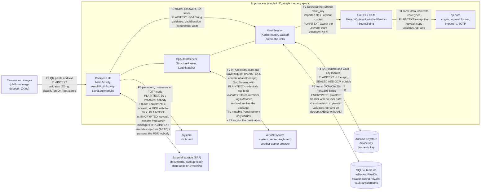

# Attack surface

Inventory of OpenPassword's untrusted inputs, with the code that receives them, who
validates them and whether there is fuzzing. It is the entry point for the auditor: it says **where hostile data comes in**,
not whether the defenses are sufficient (that is [`internal-review.md`](internal-review.md)) and
[`threat-model-review.md`](threat-model-review.md))).

State verified on 2026-10-30 against the working tree (`HEAD` `700f1a7` plus uncommitted changes, already
committed in `a3daf4e`: `SecretString`, mobile KDF ceiling, KDBX budget, public suffix list, new
fuzzing targets and `deny.toml`). A later **uncommitted** block (autofill token, browser check, KDBX ceiling, `cfg(fuzzing)` guard) is reflected in 2.3, 2.8 and 2.9. The `file:line` references are from that state. A line can be
checked with `sed -n 'Np' file`; a claim of absence, with `grep`.

Scope: `op-core`, `op-ffi`, the Android app and the `.opvault` v1 format. The CLI (`cli/`) is out of scope
([`decisions.md`](decisions.md))). Even so it shares `op-core`, so the parsers in `op-core` are the
same.

## 1. Trust map

Reading the map:

- **There is no process boundary** between the UI, autofill, `VaultSession`, `op-ffi` and `op-core`:
  everything lives in the same process and the same memory space (`OpAutofillService` and
  `OpenPasswordApp` share a process; `OpAutofillService.kt:31` uses `application as OpenPasswordApp`).
  A crash or a memory leak in `op-core` affects the whole app. The only real barrier between
  Kotlin and Rust is types and ownership (`SecretString`, `Zeroizing`), not privileges.
- **JVM memory is on the "plaintext" side**: F1, F6 and F7 carry immutable `String`s that cannot
  be wiped (residue accepted in [`decisions.md`](decisions.md)), ADR-AUD-02).
- **Everything that leaves to F5 and F8 as `.opvault` or item is encrypted**; what leaves in plaintext is the
  header (no user data, `core/src/vault/mod.rs:21-33`), the emergency kit (the SK) and what
  the user copies to the clipboard.
- **Outside the trust boundary** (the threat model assumes them uncompromised): the
  operating system, the hardware, the Keystore and `system_server`. A keyboard, another app with focus or a
  document provider **are** untrusted third parties.

| Boundary | Data crossing it | State | Who validates | Where |
|---|---|---|---|---|
| F1 UI → `VaultSession` | Master password, SK, field values, notes | Plaintext (JVM `String`) | `VaultSession` (exponential wait after 4 failures, 30 s doubling up to 1 h) | `VaultSession.kt:103-104`, `477-481` |
| F2 `VaultSession` → UniFFI | `SecretString` (password, SK, values, notes, TOTP seed); `Vec<u8>` (vault key, key file, imported files, `.opvault` copy) | Plaintext; the `.opvault` copy is encrypted | `op-ffi`: `SecretKey::parse`, `parse_header`, `check_mobile_kdf`, 32-byte length of the vault key | `ffi/src/lib.rs:325`, `338`, `353-355`, `365-373`, `472-481` |
| F3 `op-ffi` → `op-core` | The same, with core types | Plaintext; copy encrypted | `op-core`: `check_bounds`, AEAD with context AAD, padding, `serde` | `core/src/crypto/kdf.rs:48-64`, `core/src/backup/mod.rs:83-108`, `core/src/vault/mod.rs:195-219` |
| F4 `VaultSession` ↔ Keystore | SK (sealed with AES-256-GCM of the device key); vault key (sealed with the biometric key, one use per authentication) | Plaintext inside the app; sealed outside | Keystore: `setUnlockedDeviceRequired`, `setUserAuthenticationRequired`, invalidation when a biometric is enrolled | `DeviceKeyStore.kt:42-53`, `BiometricKeyStore.kt:40-56` |
| F5 `VaultStorage` ↔ SQLite and files | `overview`/`details`/`wrapped_item_key` blobs; `id` and `revision` in plaintext; JSON header; sealed `secret-key.bin` | Encrypted (except `id`, `revision` and header) | `op-core` on decrypt; SQLite validates nothing | `ItemDatabase.kt:21-33`, `VaultStorage.kt:35-76` |
| F6 UI → clipboard | Password, username or TOTP code | Plaintext, 30 s | Nobody (the `OpenPassword` label is only useful for wiping) | `SensitiveClipboard.kt:21-39` |
| F7 `OpAutofillService` ↔ system | In: `AssistStructure` and `SaveRequest` (including the password typed in the other app); out: `Dataset` with credentials | Plaintext | `StructureParser`, `LoginMatcher`, `PublicSuffix`; Android verifies the package name | `OpAutofillService.kt:28-81` |
| F8 UI ↔ external storage | Out: `.opvault`, kit PDF, automatic backup. In: `.opvault`, exports from other managers, key files, images | `.opvault`: encrypted. Kit PDF and exports: **plaintext** | `.opvault`: `op-core`. Exports: importers. Kit PDF: nobody | `Components.kt:156-177`, `AutoBackup.kt:124-146` |
| F9 camera and images → UI | Frames (Y plane) and pixels of a chosen image | Plaintext | ZXing, `classifyTotpQr`, `Totp::parse` | `QrScanner.kt`, `QrDecoder.kt:22-52` |

## 2. Inventory of untrusted inputs

Columns: **Input** · **where it comes from and who controls it** · **entry point** · **validation and
limits** · **fuzzing**. Limits are cited with their constant.

### 2.1 `.opvault` copy

- **Who controls it**: anyone who can leave a file where the user chooses it (compromised
  cloud, document provider, email, A3/A4/A5). The password and the SK are set by the user.
- **Path**: `readBackupFile` (`ui/Components.kt:156-169`, cap **64 MiB** at `:171`) →
  `backupKdf` (`ffi/src/lib.rs:494`, no secrets, checks `check_bounds`) → `kdfMemoryFits`
  (`session/KdfMemory.kt:10-11`: `m_kib × 1024 ≤ RAM / 2`) → `openBackup` (`ffi/src/lib.rs:456`) →
  `check_mobile_kdf` (`:472`) → `backup::open` (`core/src/backup/mod.rs`) → `UnlockedVault::unlock` →
  `stream::decrypt` → `serde_json::from_slice::<Body>`.
- **Validation**: magic `OPVAULT\x01` and version (`backup/mod.rs:83-92`); header ≤ **64 KiB**
  (`MAX_HEADER_LEN`, `:15`, `:93`); `check_bounds` before asking for the password (`:101`); mobile ceiling of
  **512 MiB / 6 / 8** (`ffi/src/lib.rs:33`); `secret_key_id` before deriving
  (`core/src/vault/mod.rs:105-107`); AEAD STREAM with AAD = SHA-256 of the header region
  (`backup/mod.rs:46-48`).
- **There is no body size cap in Rust**: only Kotlin limits it (64 MiB).
- **Fuzzing**: `backup_header` (plaintext part) and `backup_body` (body sealed with a fixed key, no KDF).

### 2.2 Local data: header, SQLite rows, sealed files

- **Who controls them**: whoever writes to `noBackupFilesDir` and to `items.db` (the system itself, a faulty
  restore, or an attacker with root, out of scope). It is treated as an untrusted input
  because the AEAD is the only thing that guarantees its integrity.
- **Path**: `VaultStorage.readHeader` (`VaultStorage.kt:37`) → `parse_header` (`ffi/src/lib.rs:325`);
  `ItemDatabase.all` (`ItemDatabase.kt:37-52`) → `EncryptedItemRecord::try_from` (`ffi/src/lib.rs:264-279`,
  `id` as 16-byte hexadecimal) → `decrypt_overview`/`decrypt_details`
  (`core/src/vault/mod.rs:195-203`); `readBiometricVaultKey` (`VaultSession.kt:255-267`, checks size
  and version).
- **Validation**: AEAD with AAD that binds vault, item, revision and part
  (`core/src/vault/mod.rs:63-76`); `unpad` (`vault/padding.rs:21-31`).
- **Not validated**: `revision` is stored as is (rolling an item back to a complete earlier
  revision is not detected, A6 accepted).
- **Fuzzing**: `vault_json`, `item_open`, `item_plaintext`, `ffi_records`.

### 2.3 KeePass databases (KDBX 3.1 and 4) and their XML

- **Who controls them**: the author of the file, **who also chooses the password and the key
  file** that the user types. The KDF runs before anything can be checked.
- **Path**: `readExternalExport` (`ui/settings/ExternalImport.kt:50-58`) → `parseImport`
  (`ffi/src/lib.rs:542`) → `import::parse_with_credentials` (`core/src/import/mod.rs:56`) →
  `kdbx::parse` (`import/kdbx.rs:161`) → decryption → gunzip → `read_entries` (`:640`).
- **Validation**: input ≤ **32 MiB** (`MAX_INPUT`, `import/mod.rs:34`, `:59`); `Cursor::take` with
  `checked_add` (`kdbx.rs:75-83`); AES-KDF ≤ **200 million** rounds (`:35`); Argon2 ≤ **512 MiB**,
  ≤ **1000** passes, ≤ **64** lanes and `memory × passes ≤ 3 GiB·pass` (`:36-42`, `:544-555`; aligned with the `.opvault` mobile ceiling);
  HMAC per block in KDBX 4; gunzip bounded to `MAX_INPUT + 1` (`:331-337`); `quick-xml` with
  entities resolved by hand (`:598-612`).
- **XML limits** (`a3daf4e`, ID-INT-01 fixed): 100 open groups, 256 open elements and 100 000 entries (`kdbx.rs:47-51`).
- **There is not**: application of the `.opvault` mobile ceiling to the KeePass KDF (see ID-INT-02).
- **Fuzzing** (`a3daf4e`, ID-INT-25 fixed): `import` calls `kdbx_fuzzing::file` (header and checks before the KDF with a fixed key);
  `kdbx_container` seals a KDBX with that key and reaches the block streams, the outer cipher, gunzip, the inner header and the XML;
  `kdbx_xml` walks the XML already decrypted; `key_file`, the key file. The KDF itself is not fuzzed.

### 2.4 KeePass key file

- **Path**: `keyFileLauncher` (`ExternalImport.kt:187-198`, uses `readBackupFile`, 64 MiB cap) →
  `parse_import(key_file)` → `key_file_key` (`kdbx.rs:387`).
- **Validation**: fixed formats (XML v1 with base64, XML v2 with a 4-byte hash, 32 raw bytes, 64
  hexadecimal characters, or SHA-256 of the content); if it is not XML, it is not parsed (`kdbx.rs:393-396`).
- **Fuzzing**: `key_file`.

### 2.5 Exports from other managers: CSV, Bitwarden JSON, `.1pux`

- **Who controls them**: whoever delivers the file (the user believes it is their own export).
- **Path**: same as 2.3 up to `parse_with_credentials`, which recognises the format by content:
  `PK\x03\x04` → `parse_1pux` (`import/mod.rs:497`); text starting with `{` →
  `parse_bitwarden_json` (`:332`); everything else → `parse_csv` (`:262`, `csv_records` at `:227`).
- **Validation**: ≤ 32 MiB; `.1pux`: only the `export.data` entry is read, with `take(MAX_INPUT + 1)`
  (`:504-512`) against ZIP bombs; JSON with `serde_json`'s default recursion limit (128).
- **Fuzzing**: `import`.

### 2.6 `otpauth://` links and base32 secrets

- **Who controls them**: a hostile QR, a clipboard, an imported export, the field itself.
- **Path**: Kotlin `classifyTotpQr` (`qr/QrDecoder.kt:49-52`, only `otpauth://totp/`) and
  `isValidTotp` (`ItemEditorScreen.kt:330`) → `totp_code` (`ffi/src/lib.rs:588`) → `Totp::parse`
  (`core/src/totp.rs:74`).
- **Validation**: input ≤ **4096** bytes (`:76-78`); 6 to 8 digits and a period of 1 to **3600** s
  (`:57-62`); secret of at least 10 bytes (`:187-193`); only `totp`, not `hotp`.
- **Fuzzing**: `totp`.

### 2.7 Images and QR codes

- **Who controls them**: whoever made the image the user chooses, or whatever the camera points at. Besides
  our own code, **the image goes through the platform decoder**
  (`ImageDecoder`) before reaching ZXing, and that is native system code we do not audit.
- **Path**: `decodeQrImage` (`qr/QrScanner.kt:163-177`) → `ImageDecoder.decodeBitmap` with downsampling if
  the side exceeds **1600 px** (`MAX_SIDE`) → `QrDecoder.fromArgb`; camera: `QrDecoder.fromLuminance`
  (`:22-23`) with the Y plane from CameraX.
- **Validation**: only `BarcodeFormat.QR_CODE` (`QrDecoder.kt:16`); the resulting text goes through 2.6.
- **Fuzzing**: none (postponed, see [`fuzzing.md`](fuzzing.md))).

### 2.8 Autofill `AssistStructure`

- **Who controls it**: **any app or page the user opens**. Android verifies the package
  name (`structure.activityComponent`), but the rest of the tree (`webDomain`, ids, texts, hints,
  `htmlInfo`, depth) is filled in by the originating app.
- **Path**: `OpAutofillService.onFillRequest` (`OpAutofillService.kt:28`) and `onSaveRequest` (`:66`)
  → `StructureParser.parse` (`StructureParser.kt:27`) and `textValue` (`:14`) → `FieldClassifier.classify`
  → `LoginMatcher.matches` (`LoginMatcher.kt:22`) → `PublicSuffix`.
- **Validation**: own package excluded (`StructureParser.kt:29`); strict host matching
  (exact host or subdomain of a registrable domain according to the public suffix list,
  `LoginMatcher.kt:43-48`); exact package for apps; a web login never works for an app.
- **`webDomain`** (ID-INT-16 fixed; the `a3daf4e` fix was completed without commit): it is only accepted if the package is a browser (`StructureParser.targetFor`, `:27-28`): one of `KnownBrowsers.PACKAGES` or the default browser that handles `https` and `http` (`BrowserCheck.kt:68-73`). An `intent-filter` alone is not enough. The host must be an ASCII name (`[a-z0-9.-]+`, `LoginMatcher.kt:67-76`) and, if the suffix list fails to load (`IOException`), the exact host is compared (`PublicSuffix.kt:21-25`). Not handled: an `iframe` from another origin inside a browser.
- **There is not**: a depth limit in the recursion (see ID-INT-18).
- **Fuzzing**: none for `StructureParser` (it depends on `AssistStructure`);
  `LoginMatcher` and `FieldClassifier` have deterministic invariant tests
  (`LoginMatcherTest.kt`, seeds `Random(20260630)` and `Random(7)`).

### 2.9 Intents, `PendingIntent` and tokens

- **Activities**: `MainActivity` is the only one with `exported="true"` (`AndroidManifest.xml:39-48`,
  `MAIN`/`LAUNCHER`; it **does not read** data from the intent: `grep -n intent MainActivity.kt` returns nothing).
  `AutofillAuthActivity` and `SaveLoginActivity` have `exported="false"` (`:51-64`).
- **Service**: `OpAutofillService` is exported but requires `BIND_AUTOFILL_SERVICE`, a permission that
  only the system has (`:67-71`).
- **Extras accepted**: `AutofillAuthActivity` reads only `op.autofill.token` (`Datasets.kt:73`):
  16 random bytes in hexadecimal, single-use and with a 5 min TTL, pointing to an in-memory store
  of the process (`AutofillRequestTokens.kt`) where the destination (domain or package) and the field
  ids are kept. The old extras (`op.autofill.domain`, `package`, `username`, `password`;
  `Datasets.LEGACY_EXTRAS`, `:76`) are **wiped** without being read (`AutofillAuthActivity.kt:89`) and, without a valid
  token, the activity finishes with no result (`:91-98`). The `PendingIntent` is **mutable** because the
  system adds the structure (`Datasets.kt:50-55`), with an explicit `Intent`, and **it is handed to the app
  being filled in**, which can add extras to it with `Intent.fillIn` (ID-INT-26). `SaveLoginActivity` only reads `op.save.token`
  (`SaveLoginActivity.kt:79-80`), a random 16-byte value from `SecureRandom` with a 5 min
  lifetime (`PendingSaves.kt:15-24`); the save `PendingIntent` is immutable
  (`OpAutofillService.kt:74-79`).
- **Who validates**: the non-export of the activities; the token not being guessable. **Correction**: before,
  it was claimed that a forged domain in the extras was useless without controlling the `PendingIntent`;
  that was false, because the filled-in app does control it (ID-INT-26). That is why the destination no longer travels in
  extras but in the token store.
- **Fuzzing**: none.

### 2.10 Storage Access Framework URIs

- **Who controls them**: the document provider the user chooses, which can be any app
  (cloud, Syncthing, a malicious provider). For the provider, what is read and what is
  written is untrusted in integrity and availability; in confidentiality only what is
  written in plaintext matters.
- **Inputs**: `OpenDocument` for restoring (`RestoreScreen.kt:48`), importing a backup
  (`SettingsScreen.kt:131`), importing from another manager (`:89`), key file (`ExternalImport.kt:187`)
  and QR image (`ItemEditorScreen.kt:149`).
- **Outputs**: `CreateDocument` for exporting (`SettingsScreen.kt:142`, encrypted), and for the emergency
  kit (`SettingsScreen.kt:116`, `OnboardingScreen.kt:192`, **the SK in plaintext**);
  `OpenDocumentTree` for the automatic backup (`SettingsScreen.kt:104` → `AutoBackup.setFolder`, with
  `takePersistableUriPermission`, `AutoBackup.kt:52-60`), which creates files and **deletes** its own
  old ones (`:133-145`, keeps 10).
- **Validation**: 64 MiB read cap; copies are encrypted; no check on what
  is in the folder, except the `BackupNames` name pattern.

### 2.11 Other system inputs (low risk)

| Input | Where | Note |
|---|---|---|
| `Settings.Global.BOOT_COUNT` | `OpenPasswordApp.kt:63` | Only decides whether the password is required after a reboot |
| Existence of files and packages (`su`, Magisk…) | `AndroidDeviceProbe.kt:12-24` | A10 heuristic, it only warns |
| `SharedPreferences` (`security`, `backup`, `device_warning`) | `VaultSession.kt`, `AutoBackup.kt` | Attempt counters, backup folder; only the app writes |
| `public_suffix_list.dat` | `android/app/src/main/resources/` | APK resource, 338 012 bytes; loaded once (`PublicSuffix.kt:18`) |
| Text written by the user | Compose | No validation: it is the user themselves |

### 2.12 What is **not** an input

- **There is no network**: neither `INTERNET` nor `ACCESS_NETWORK_STATE` (`VerifyManifest`,
  `android/app/build.gradle.kts:163-180`); there is no `WebView`, no `DeepLink`, no `ContentProvider`, no
  exported `BroadcastReceiver` (the only receiver is the `ACTION_SCREEN_OFF` one, registered in code
  in `OpenPasswordApp.kt:75-83`). `grep -rn "ContentProvider\|WebView" android/app/src/main` returns
  nothing.
- **There is no system backup**: `allowBackup="false"` and `data_extraction_rules.xml`
  excludes all domains.

## 3. Summary by surface

| Surface | Who attacks it | Native code involved | Fuzzing | Findings |
|---|---|---|---|---|
| `.opvault` | Cloud, email, provider | `op-core` (Rust) | Yes (2 targets) | None open (ID-INT-05 fixed) |
| Local data | Root (out of scope), corruption | `op-core` | Yes (4 targets) | ID-INT-06, ID-INT-10 |
| KDBX and its XML | Author of the file | `op-core` + `argon2`, `aes`, `quick-xml`, `flate2` | Partial (everything except the KDF) | ID-INT-02, ID-INT-03 (ID-INT-01 and ID-INT-25 fixed) |
| CSV, Bitwarden, `.1pux` | Author of the file | `op-core` + `zip`, `serde_json` | Yes | ID-INT-03 |
| `otpauth://` | QR, clipboard | `op-core` | Yes | No findings |
| Images and QR | Author of the image | System decoders + ZXing | No | No findings of our own |
| `AssistStructure` | Any app | Kotlin | No (Jazzer postponed) | ID-INT-17, ID-INT-18, ID-INT-19 (ID-INT-16 and ID-INT-26 fixed) |
| Intents and tokens | Other apps | Kotlin | No | No findings |
| SAF URIs | Document provider | Kotlin | No | ID-INT-11, ID-INT-12 |
| Clipboard (output) | Keyboard, app with focus | Kotlin | No | ID-INT-14, ID-INT-15 |

## 4. What should be looked at first

1. **Autofill** (2.8): it is the only surface where an app the user installs controls
   the content that decides who the credentials are handed to.
2. **The KeePass importers** (2.3): the attacker controls the file and the password, and the
   cost is paid by the phone.
3. **The Kotlin↔Rust edge** (F2/F3): an app with a single process makes a failure of the core look
   like a failure of the whole app. `panic = "unwind"` and catching `InternalException` reduce the
   effect of a *panic*, not that of an out-of-memory (it aborts anyway).
