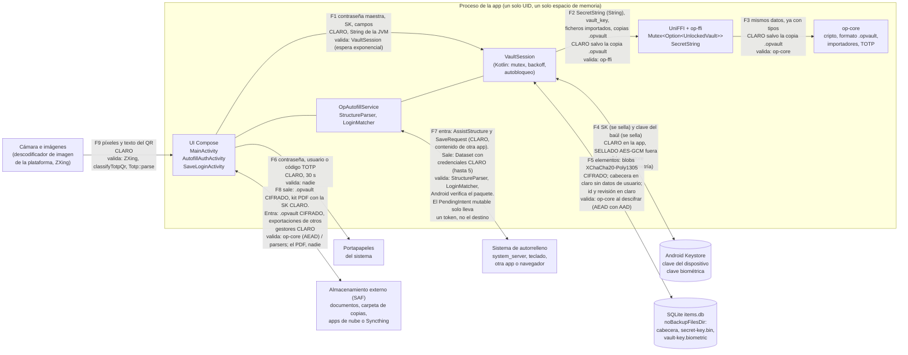

# Superficie de ataque

Inventario de las entradas no confiables de OpenPassword, con el código que las recibe, quién las
valida y si hay fuzzing. Es la entrada para el auditor: dice **por dónde entran los datos hostiles**,
no si las defensas son suficientes (eso es [`internal-review.md`](internal-review.md)) y
[`threat-model-review.md`](threat-model-review.md))).

Estado verificado el 2026-10-30 sobre el árbol de trabajo (`HEAD` `3725741` más cambios sin confirmar, ya
confirmados en `2bd56ce`: `SecretString`, techo móvil de KDF, presupuesto de KDBX, lista de sufijos públicos, objetivos de
fuzzing nuevos y `deny.toml`). Un bloque posterior **sin commit** (token de autorrelleno, comprobación de navegador, techo de KDBX, guardia de `cfg(fuzzing)`) está reflejado en 2.3, 2.8 y 2.9. Las referencias `fichero:línea` son de ese estado. Una línea se puede
comprobar con `sed -n 'Np' fichero`; una afirmación de ausencia, con `grep`.

Alcance: `op-core`, `op-ffi`, la app Android y el formato `.opvault` v1. La CLI (`cli/`) queda fuera
([`decisions.md`](decisions.md))). Aun así comparte `op-core`, así que los parsers de `op-core` son los
mismos.

## 1. Mapa de confianza

Lectura del mapa:

- **No hay frontera de proceso** entre la UI, el autorrelleno, `VaultSession`, `op-ffi` y `op-core`:
  todo vive en el mismo proceso y en el mismo espacio de memoria (`OpAutofillService` y
  `OpenPasswordApp` comparten proceso; `OpAutofillService.kt:31` usa `application as OpenPasswordApp`).
  Una caída o una fuga de memoria en `op-core` afecta a toda la app. La única barrera real entre
  Kotlin y Rust es de tipos y de propiedad (`SecretString`, `Zeroizing`), no de privilegios.
- **La memoria de la JVM está del lado de «claro»**: F1, F6 y F7 llevan `String` inmutables que no se
  pueden borrar (residuo aceptado en [`decisions.md`](decisions.md)), ADR-AUD-02).
- **Todo lo que sale a F5 y F8 como `.opvault` o elemento está cifrado**; lo que sale en claro es la
  cabecera (sin datos de usuario, `core/src/vault/mod.rs:21-33`), el kit de emergencia (la SK) y lo que
  el usuario copia al portapapeles.
- **Fuera de la frontera de confianza** (el modelo de amenazas los supone no comprometidos): el
  sistema operativo, el hardware, el Keystore y `system_server`. Un teclado, otra app con foco o un
  proveedor de documentos **sí** son terceros no confiables.

| Frontera | Datos que la cruzan | Estado | Quién valida | Dónde |
|---|---|---|---|---|
| F1 UI → `VaultSession` | Contraseña maestra, SK, valores de campo, notas | Claro (`String` JVM) | `VaultSession` (espera exponencial tras 4 fallos, 30 s duplicándose hasta 1 h) | `VaultSession.kt:103-104`, `477-481` |
| F2 `VaultSession` → UniFFI | `SecretString` (contraseña, SK, valores, notas, semilla TOTP); `Vec<u8>` (clave del baúl, archivo de clave, ficheros importados, copia `.opvault`) | Claro; la copia `.opvault` va cifrada | `op-ffi`: `SecretKey::parse`, `parse_header`, `check_mobile_kdf`, longitud de 32 bytes de la clave del baúl | `ffi/src/lib.rs:325`, `338`, `353-355`, `365-373`, `472-481` |
| F3 `op-ffi` → `op-core` | Los mismos, con tipos del núcleo | Claro; copia cifrada | `op-core`: `check_bounds`, AEAD con AAD de contexto, padding, `serde` | `core/src/crypto/kdf.rs:48-64`, `core/src/backup/mod.rs:83-108`, `core/src/vault/mod.rs:195-219` |
| F4 `VaultSession` ↔ Keystore | SK (se sella con AES-256-GCM de la clave del dispositivo); clave del baúl (se sella con la clave biométrica, un uso por autenticación) | Claro dentro de la app; sellado fuera | Keystore: `setUnlockedDeviceRequired`, `setUserAuthenticationRequired`, invalidación al dar de alta una biometría | `DeviceKeyStore.kt:42-53`, `BiometricKeyStore.kt:40-56` |
| F5 `VaultStorage` ↔ SQLite y ficheros | Blobs `overview`/`details`/`wrapped_item_key`; `id` y `revision` en claro; cabecera JSON; `secret-key.bin` sellado | Cifrado (salvo `id`, `revision` y cabecera) | `op-core` al descifrar; SQLite no valida nada | `ItemDatabase.kt:21-33`, `VaultStorage.kt:35-76` |
| F6 UI → portapapeles | Contraseña, usuario o código TOTP | Claro, 30 s | Nadie (la etiqueta `OpenPassword` solo sirve para borrar) | `SensitiveClipboard.kt:21-39` |
| F7 `OpAutofillService` ↔ sistema | Entra `AssistStructure` y `SaveRequest` (incluida la contraseña tecleada en la otra app); sale `Dataset` con credenciales | Claro | `StructureParser`, `LoginMatcher`, `PublicSuffix`; Android verifica el nombre de paquete | `OpAutofillService.kt:28-81` |
| F8 UI ↔ almacenamiento externo | Sale: `.opvault`, kit PDF, copia automática. Entra: `.opvault`, exportaciones de otros gestores, archivos de clave, imágenes | `.opvault`: cifrado. Kit PDF y exportaciones: **claro** | `.opvault`: `op-core`. Exportaciones: importadores. Kit PDF: nadie | `Components.kt:156-177`, `AutoBackup.kt:124-146` |
| F9 cámara e imágenes → UI | Fotogramas (plano Y) y píxeles de una imagen elegida | Claro | ZXing, `classifyTotpQr`, `Totp::parse` | `QrScanner.kt`, `QrDecoder.kt:22-52` |

## 2. Inventario de entradas no confiables

Columnas: **Entrada** · **de dónde viene y quién la controla** · **punto de entrada** · **validación y
límites** · **fuzzing**. Los límites se citan con su constante.

### 2.1 Copia `.opvault`

- **Quién la controla**: cualquiera que pueda dejar un fichero donde el usuario lo elija (nube
  comprometida, proveedor de documentos, correo, A3/A4/A5). La contraseña y la SK las pone el usuario.
- **Camino**: `readBackupFile` (`ui/Components.kt:156-169`, tope **64 MiB** en `:171`) →
  `backupKdf` (`ffi/src/lib.rs:494`, sin secretos, comprueba `check_bounds`) → `kdfMemoryFits`
  (`session/KdfMemory.kt:10-11`: `m_kib × 1024 ≤ RAM / 2`) → `openBackup` (`ffi/src/lib.rs:456`) →
  `check_mobile_kdf` (`:472`) → `backup::open` (`core/src/backup/mod.rs`) → `UnlockedVault::unlock` →
  `stream::decrypt` → `serde_json::from_slice::<Body>`.
- **Validación**: magia `OPVAULT\x01` y versión (`backup/mod.rs:83-92`); cabecera ≤ **64 KiB**
  (`MAX_HEADER_LEN`, `:15`, `:93`); `check_bounds` antes de pedir la contraseña (`:101`); techo móvil de
  **512 MiB / 6 / 8** (`ffi/src/lib.rs:33`); `secret_key_id` antes de derivar
  (`core/src/vault/mod.rs:105-107`); AEAD STREAM con AAD = SHA-256 de la región de cabecera
  (`backup/mod.rs:46-48`).
- **No hay tope de tamaño del cuerpo en Rust**: lo limita solo Kotlin (64 MiB).
- **Fuzzing**: `backup_header` (parte en claro) y `backup_body` (cuerpo sellado con clave fija, sin KDF).

### 2.2 Datos locales: cabecera, filas de SQLite, ficheros sellados

- **Quién los controla**: quien escriba en `noBackupFilesDir` y en `items.db` (el propio sistema, una
  restauración defectuosa, o un atacante con root, fuera de alcance). Se trata como entrada no
  confiable porque el AEAD es lo único que garantiza su integridad.
- **Camino**: `VaultStorage.readHeader` (`VaultStorage.kt:37`) → `parse_header` (`ffi/src/lib.rs:325`);
  `ItemDatabase.all` (`ItemDatabase.kt:37-52`) → `EncryptedItemRecord::try_from` (`ffi/src/lib.rs:264-279`,
  `id` hexadecimal de 16 bytes) → `decrypt_overview`/`decrypt_details`
  (`core/src/vault/mod.rs:195-203`); `readBiometricVaultKey` (`VaultSession.kt:255-267`, comprueba tamaño
  y versión).
- **Validación**: AEAD con AAD que enlaza baúl, elemento, revisión y parte
  (`core/src/vault/mod.rs:63-76`); `unpad` (`vault/padding.rs:21-31`).
- **Sin validar**: `revision` se guarda tal cual (la reversión de un elemento a una revisión anterior
  completa no se detecta, A6 aceptado).
- **Fuzzing**: `vault_json`, `item_open`, `item_plaintext`, `ffi_records`.

### 2.3 Bases de KeePass (KDBX 3.1 y 4) y su XML

- **Quién la controla**: el autor del fichero, **que también elige la contraseña y el archivo de
  clave** que el usuario teclea. La KDF corre antes de que se pueda comprobar nada.
- **Camino**: `readExternalExport` (`ui/settings/ExternalImport.kt:50-58`) → `parseImport`
  (`ffi/src/lib.rs:542`) → `import::parse_with_credentials` (`core/src/import/mod.rs:56`) →
  `kdbx::parse` (`import/kdbx.rs:161`) → descifrado → gunzip → `read_entries` (`:640`).
- **Validación**: entrada ≤ **32 MiB** (`MAX_INPUT`, `import/mod.rs:34`, `:59`); `Cursor::take` con
  `checked_add` (`kdbx.rs:75-83`); AES-KDF ≤ **200 millones** de rondas (`:35`); Argon2 ≤ **512 MiB**,
  ≤ **1000** pasadas, ≤ **64** carriles y `memoria × pasadas ≤ 3 GiB·pasada` (`:36-42`, `:544-555`; alineado con el techo móvil de `.opvault`);
  HMAC por bloque en KDBX 4; gunzip acotado a `MAX_INPUT + 1` (`:331-337`); `quick-xml` con
  entidades resueltas a mano (`:598-612`).
- **Límites del XML** (`2bd56ce`, ID-INT-01 corregido): 100 grupos abiertos, 256 elementos abiertos y 100 000 entradas (`kdbx.rs:47-51`).
- **No hay**: aplicación del techo móvil de `.opvault` a la KDF de KeePass (ver ID-INT-02).
- **Fuzzing** (`2bd56ce`, ID-INT-25 corregido): `import` llama a `kdbx_fuzzing::file` (cabecera y comprobaciones previas a la KDF con una clave fija);
  `kdbx_container` sella un KDBX con esa clave y llega a los flujos de bloques, el cifrado externo, el gunzip, la cabecera interna y el XML;
  `kdbx_xml` recorre el XML ya descifrado; `key_file`, el archivo de clave. La KDF en sí no se fuzzea.

### 2.4 Archivo de clave de KeePass

- **Camino**: `keyFileLauncher` (`ExternalImport.kt:187-198`, usa `readBackupFile`, tope 64 MiB) →
  `parse_import(key_file)` → `key_file_key` (`kdbx.rs:387`).
- **Validación**: formatos fijos (XML v1 con base64, XML v2 con hash de 4 bytes, 32 bytes crudos, 64
  hexadecimales, o SHA-256 del contenido); si no es XML, no se analiza (`kdbx.rs:393-396`).
- **Fuzzing**: `key_file`.

### 2.5 Exportaciones de otros gestores: CSV, JSON de Bitwarden, `.1pux`

- **Quién las controla**: quien entregue el fichero (el usuario cree que es su exportación).
- **Camino**: igual que 2.3 hasta `parse_with_credentials`, que reconoce el formato por contenido:
  `PK\x03\x04` → `parse_1pux` (`import/mod.rs:497`); texto que empieza por `{` →
  `parse_bitwarden_json` (`:332`); lo demás → `parse_csv` (`:262`, `csv_records` en `:227`).
- **Validación**: ≤ 32 MiB; `.1pux`: solo se lee la entrada `export.data`, con `take(MAX_INPUT + 1)`
  (`:504-512`) contra bombas de ZIP; JSON con el límite de recursión por defecto de `serde_json` (128).
- **Fuzzing**: `import`.

### 2.6 Enlaces `otpauth://` y secretos base32

- **Quién los controla**: un QR hostil, un portapapeles, una exportación importada, el propio campo.
- **Camino**: Kotlin `classifyTotpQr` (`qr/QrDecoder.kt:49-52`, solo `otpauth://totp/`) y
  `isValidTotp` (`ItemEditorScreen.kt:330`) → `totp_code` (`ffi/src/lib.rs:588`) → `Totp::parse`
  (`core/src/totp.rs:74`).
- **Validación**: entrada ≤ **4096** bytes (`:76-78`); 6 a 8 dígitos y periodo de 1 a **3600** s
  (`:57-62`); secreto de al menos 10 bytes (`:187-193`); solo `totp`, no `hotp`.
- **Fuzzing**: `totp`.

### 2.7 Imágenes y códigos QR

- **Quién las controla**: quien haya fabricado la imagen que el usuario elige, o lo que apunte la
  cámara. Además del código propio, **la imagen pasa por el descodificador de la plataforma**
  (`ImageDecoder`) antes de llegar a ZXing, y eso es código nativo del sistema que no auditamos.
- **Camino**: `decodeQrImage` (`qr/QrScanner.kt:163-177`) → `ImageDecoder.decodeBitmap` con muestreo si
  el lado supera **1600 px** (`MAX_SIDE`) → `QrDecoder.fromArgb`; cámara: `QrDecoder.fromLuminance`
  (`:22-23`) con el plano Y de CameraX.
- **Validación**: solo `BarcodeFormat.QR_CODE` (`QrDecoder.kt:16`); el texto resultante pasa por 2.6.
- **Fuzzing**: ninguno (se pospone, ver [`fuzzing.md`](fuzzing.md))).

### 2.8 `AssistStructure` del autorrelleno

- **Quién la controla**: **cualquier app o página que el usuario abra**. Android verifica el nombre de
  paquete (`structure.activityComponent`), pero el resto del árbol (`webDomain`, ids, textos, pistas,
  `htmlInfo`, profundidad) lo rellena la app de origen.
- **Camino**: `OpAutofillService.onFillRequest` (`OpAutofillService.kt:28`) y `onSaveRequest` (`:66`)
  → `StructureParser.parse` (`StructureParser.kt:27`) y `textValue` (`:14`) → `FieldClassifier.classify`
  → `LoginMatcher.matches` (`LoginMatcher.kt:22`) → `PublicSuffix`.
- **Validación**: paquete propio excluido (`StructureParser.kt:29`); coincidencia estricta de host
  (host exacto o subdominio de un dominio registrable según la lista de sufijos públicos,
  `LoginMatcher.kt:43-48`); paquete exacto para apps; un login web nunca vale para una app.
- **`webDomain`** (ID-INT-16 corregido; la corrección de `2bd56ce` se completó sin commit): solo se acepta si el paquete es un navegador (`StructureParser.targetFor`, `:27-28`): uno de `KnownBrowsers.PACKAGES` o el navegador por defecto que atiende `https` y `http` (`BrowserCheck.kt:68-73`). Un `intent-filter` por sí solo no basta. El host debe ser un nombre ASCII (`[a-z0-9.-]+`, `LoginMatcher.kt:67-76`) y, si la lista de sufijos no carga (`IOException`), se compara el host exacto (`PublicSuffix.kt:21-25`). Sin tratar: `iframe` de otro origen en un navegador.
- **No hay**: límite de profundidad en la recursión (ver ID-INT-18).
- **Fuzzing**: ninguno para `StructureParser` (depende de `AssistStructure`);
  `LoginMatcher` y `FieldClassifier` tienen tests de invariantes deterministas
  (`LoginMatcherTest.kt`, semillas `Random(20260630)` y `Random(7)`).

### 2.9 Intents, `PendingIntent` y tokens

- **Actividades**: `MainActivity` es la única con `exported="true"` (`AndroidManifest.xml:39-48`,
  `MAIN`/`LAUNCHER`; **no lee** datos del intent: `grep -n intent MainActivity.kt` no da resultados).
  `AutofillAuthActivity` y `SaveLoginActivity` tienen `exported="false"` (`:51-64`).
- **Servicio**: `OpAutofillService` está exportado pero exige `BIND_AUTOFILL_SERVICE`, un permiso que
  solo tiene el sistema (`:67-71`).
- **Extras que se aceptan**: `AutofillAuthActivity` lee solo `op.autofill.token` (`Datasets.kt:73`):
  16 bytes aleatorios en hexadecimal, de un solo uso y con TTL de 5 min, que apuntan a un almacén en
  memoria del proceso (`AutofillRequestTokens.kt`) donde están el destino (dominio o paquete) y los
  ids de campo. Los extras antiguos (`op.autofill.domain`, `package`, `username`, `password`;
  `Datasets.LEGACY_EXTRAS`, `:76`) se **borran** sin leerlos (`AutofillAuthActivity.kt:89`) y, sin token
  válido, la actividad termina sin resultado (`:91-98`). El `PendingIntent` es **mutable** porque el
  sistema añade la estructura (`Datasets.kt:50-55`), con `Intent` explícito, y **se entrega a la app
  que se rellena**, que puede añadirle extras con `Intent.fillIn` (ID-INT-26). `SaveLoginActivity` solo lee `op.save.token`
  (`SaveLoginActivity.kt:79-80`), un valor aleatorio de 16 bytes del `SecureRandom` con vida de 5
  min (`PendingSaves.kt:15-24`); el `PendingIntent` de guardado es inmutable
  (`OpAutofillService.kt:74-79`).
- **Quién valida**: la no exportación de las actividades; el token no adivinable. **Corrección**: antes
  se afirmaba que un dominio falsificado en los extras no servía sin controlar el `PendingIntent`;
  era falso, porque la app rellenada sí lo controla (ID-INT-26). Por eso el destino ya no viaja en
  extras sino en el almacén de tokens.
- **Fuzzing**: ninguno.

### 2.10 URIs del Storage Access Framework

- **Quién las controla**: el proveedor de documentos que elija el usuario, que puede ser una app
  cualquiera (nube, Syncthing, un proveedor malicioso). Para el proveedor, lo que se lee y lo que se
  escribe es no confiable en integridad y disponibilidad; en confidencialidad solo importa lo que se
  escribe en claro.
- **Entradas**: `OpenDocument` para restaurar (`RestoreScreen.kt:48`), importar copia
  (`SettingsScreen.kt:131`), importar de otro gestor (`:89`), archivo de clave (`ExternalImport.kt:187`)
  e imagen QR (`ItemEditorScreen.kt:149`).
- **Salidas**: `CreateDocument` para exportar (`SettingsScreen.kt:142`, cifrada), y para el kit de
  emergencia (`SettingsScreen.kt:116`, `OnboardingScreen.kt:192`, **la SK en claro**);
  `OpenDocumentTree` para la copia automática (`SettingsScreen.kt:104` → `AutoBackup.setFolder`, con
  `takePersistableUriPermission`, `AutoBackup.kt:52-60`), que crea ficheros y **borra** los antiguos
  propios (`:133-145`, conserva 10).
- **Validación**: tope de lectura de 64 MiB; las copias van cifradas; ninguna comprobación sobre qué
  hay en la carpeta, salvo el patrón de nombre de `BackupNames`.

### 2.11 Otras entradas del sistema (de bajo riesgo)

| Entrada | Dónde | Nota |
|---|---|---|
| `Settings.Global.BOOT_COUNT` | `OpenPasswordApp.kt:63` | Solo decide si se exige la contraseña tras un reinicio |
| Existencia de ficheros y paquetes (`su`, Magisk…) | `AndroidDeviceProbe.kt:12-24` | Heurística de A10, solo avisa |
| `SharedPreferences` (`security`, `backup`, `device_warning`) | `VaultSession.kt`, `AutoBackup.kt` | Contadores de intentos, carpeta de copias; solo escribe la app |
| `public_suffix_list.dat` | `android/app/src/main/resources/` | Recurso del APK, 338 012 bytes; se carga una vez (`PublicSuffix.kt:18`) |
| Texto escrito por el usuario | Compose | Sin validación: es el propio usuario |

### 2.12 Lo que **no** es una entrada

- **No hay red**: ni `INTERNET` ni `ACCESS_NETWORK_STATE` (`VerifyManifest`,
  `android/app/build.gradle.kts:163-180`); no hay `WebView`, ni `DeepLink`, ni `ContentProvider`, ni
  `BroadcastReceiver` exportado (el único receptor es el de `ACTION_SCREEN_OFF`, registrado por código
  en `OpenPasswordApp.kt:75-83`). `grep -rn "ContentProvider\|WebView" android/app/src/main` no da
  resultados.
- **No hay copia de seguridad del sistema**: `allowBackup="false"` y `data_extraction_rules.xml`
  excluye todos los dominios.

## 3. Resumen por superficie

| Superficie | Quién la ataca | Código nativo implicado | Fuzzing | Hallazgos |
|---|---|---|---|---|
| `.opvault` | Nube, correo, proveedor | `op-core` (Rust) | Sí (2 objetivos) | Ninguno abierto (ID-INT-05 corregido) |
| Datos locales | Root (fuera de alcance), corrupción | `op-core` | Sí (4 objetivos) | ID-INT-06, ID-INT-10 |
| KDBX y su XML | Autor del fichero | `op-core` + `argon2`, `aes`, `quick-xml`, `flate2` | Parcial (todo salvo la KDF) | ID-INT-02, ID-INT-03 (ID-INT-01 e ID-INT-25 corregidos) |
| CSV, Bitwarden, `.1pux` | Autor del fichero | `op-core` + `zip`, `serde_json` | Sí | ID-INT-03 |
| `otpauth://` | QR, portapapeles | `op-core` | Sí | Sin hallazgos |
| Imágenes y QR | Autor de la imagen | Descodificadores del sistema + ZXing | No | Sin hallazgos propios |
| `AssistStructure` | Cualquier app | Kotlin | No (Jazzer pospuesto) | ID-INT-17, ID-INT-18, ID-INT-19 (ID-INT-16 e ID-INT-26 corregidos) |
| Intents y tokens | Otras apps | Kotlin | No | Sin hallazgos |
| URIs de SAF | Proveedor de documentos | Kotlin | No | ID-INT-11, ID-INT-12 |
| Portapapeles (salida) | Teclado, app con foco | Kotlin | No | ID-INT-14, ID-INT-15 |

## 4. Qué se debería mirar primero

1. **El autorrelleno** (2.8): es la única superficie donde una app que el usuario instala controla
   el contenido que decide a quién se entregan las credenciales.
2. **Los importadores de KeePass** (2.3): el atacante controla el fichero y la contraseña, y el
   coste lo paga el teléfono.
3. **El borde Kotlin↔Rust** (F2/F3): una app con un solo proceso hace que un fallo del núcleo se vea
   como un fallo de la app entera. `panic = "unwind"` y la captura de `InternalException` reducen el
   efecto de un *panic*, no el de una falta de memoria (aborta de todos modos).
